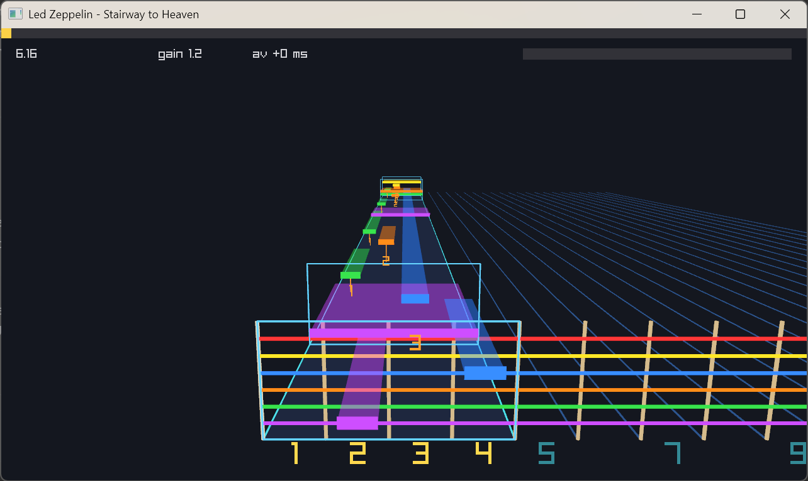

# odinrocks

Play your real electric guitar along with a song, Rocksmith style. Type a Songsterr song id, and odinrocks downloads the guitar tabs and the song recording. Then the notes fall down a 3D fretboard while the song plays. Your guitar plays through a model of a real amp and cab, so it sounds good on every screen.



> [!NOTE]
> odinrocks is a work in progress. Expect missing features and bugs. I tested it only with my Focusrite Scarlett. Other audio interfaces can work, but I did not try them.

## Disclaimer

odinrocks is a personal hobby project. It is not affiliated with Songsterr, Guitartabs LLC, YouTube, or Ubisoft. Rocksmith is a trademark of Ubisoft Entertainment.

- It uses Songsterr's web pages and YouTube's audio through `yt-dlp`. These are not official APIs, so they may change at any time.
- Tabs and recordings belong to their owners. odinrocks does not include any of them. Downloads go to your local `cache/` folder, for your own practice.
- Please check the terms of Songsterr and YouTube before you use it.

## What you need

**Hardware**

- A Windows PC.
- An electric guitar.
- An audio interface with an ASIO driver. Only a Focusrite Scarlett is tested. Connect the guitar to its instrument input.
- Speakers or headphones on the Windows default playback device.

**Software**, on your `PATH`:

- The [Odin](https://odin-lang.org/) compiler, to build the game.
- [`yt-dlp`](https://github.com/yt-dlp/yt-dlp), [`ffmpeg`](https://ffmpeg.org/), and [`qjs`](https://bellard.org/quickjs/) (QuickJS), to download songs. If one is missing, the game shows which one and does not start.

## Start

```
odin run .
```

On the first start, open **Settings** and select your ASIO driver and the input that the guitar is on (the default is the second input). When the guitar input opens, you hear your guitar. If it does not open, the settings screen tells you why in red.

Two things to know about the audio:

- odinrocks uses the playback device in exclusive mode. Other apps cannot play sound on it while odinrocks runs.
- The ASIO buffer size must match the Windows playback period, or the guitar input does not open. On a Scarlett, you set the buffer size in Focusrite Control.

## Play a song

1. Find the song on [songsterr.com](https://www.songsterr.com). The id is the number at the end of the URL.
2. In the library, type or paste (Ctrl+V) the id and press **Download** or Enter.
   - **Basic** (default) uses Songsterr's own timing. It is fast.
   - **Advanced sync** also aligns each bar to the recording. It takes longer and can fix songs where the notes drift.
3. Click the song in the library, then click the guitar part that you want to play. The most popular part is first.
4. If the part uses a different tuning than your guitar, the tuner opens first (see [Tuner](#tuner)).
5. The song opens paused. Click **Resume** to start.

In the song menu, **Delete song** (basic) or **Delete sync** (advanced) removes the download. To get a new Songsterr revision of a song, delete it and download it again.

## Controls

| Where | Key | Action |
| --- | --- | --- |
| Everywhere | F11 | Switch between borderless fullscreen and a window. |
| Everywhere | Escape or right click | Go back, or pause a song. |
| Song | Up / Down | Guitar volume. |
| Song | `[` / `]` | A/V offset by 10 ms (50 ms with Shift). |
| Song | Drag the top bar | Seek. |
| Tuner | Left / Right, or click | Select a string. |
| Settings and tone | Click the left / right half of a value | Lower / raise it (5 steps with Shift). |

The pause menu has **Resume**, **Tone**, **Restart**, and **Quit song**.

## Tuner

The tuner shows the tuning of your guitar and the tuning of the song. Pluck the selected string and tune until the needle is green (within 3 cents).

- **Play** saves the song's tuning as your guitar's tuning and starts the song.
- **Play with drop** shows when every string of the song is lower by the same amount. Your guitar stays in its tuning, and odinrocks lowers its pitch for this song only.

## Tone

Open **Tone** from the settings or from the pause menu. You hear every change while you play.

- **Rig**: an amp and cab, captured with [NAM](https://www.neuralampmodeler.com/). The names start with Clean, Crunch, or Lead.
- **Input**: how hard the guitar drives the rig, like the gain knob of an amp. The meter shows your guitar level.
- **Gate**: removes hiss between notes.
- **Delay** and **Reverb**.
- **Defaults**: resets the pedals and the input.

**If every rig sounds like fuzz**, turn down Input until a hard strum peaks near -12 dB. The rigs expect a low interface gain (on a Scarlett, the instrument gain all the way down).

**Add your own rig**: put a `.nam` file of a full rig (amp and cab, "Amp + Cab Capture" on [TONE3000](https://www.tone3000.com)) into `models/`. A capture of an amp alone sounds harsh. NAM files of the newer A2 type do not load.

## A/V offset

Your speakers and interface add a small delay. If the notes hit the line before or after you hear them, change the A/V offset with `[` and `]` during a song, or in Settings. A positive value delays the notes. One value is correct for all songs on your machine. It can change a little when you switch between fullscreen and window.

## Settings file

`settings.json`, next to the game, keeps all settings: the audio driver and input, volumes, A/V offset, hit flash, window mode, rig, pedals, and your guitar's tuning (E standard at first). The game writes it when you leave the settings, the tone screen, or a song, and when you close the game. If you remove a line, it goes back to its default.

## Troubleshooting

- **No guitar sound**: open Settings and read the red message. Check the driver, the input, and the ASIO buffer size. Close other apps that use the playback device.
- **A download fails**: the library shows the step that failed. The console shows the details. Try again: YouTube sometimes refuses a download.
- **A song disappears after a failed redownload**: download it again.

## Development

`odin run . -debug` also prints memory leaks when the game closes.

The main packages:

- `fetch`, `songsterr`, `youtube`: download the tab and the recording. `songcache`: the `cache/` folder.
- `chart`: turns a tab into notes and hand positions. `songsync`: the advanced sync.
- `asio`: guitar input. `pedals` and `nam`: the tone. `speakers`: output. `audio.odin` connects them.
- `pitch`: the tuner. `render`: the fretboard. `menu` and `ui`: the screens.

## Credits

The rigs, renamed and otherwise unchanged:

| Rig | By | License |
| --- | --- | --- |
| Clean - Two Rock Studio Signature | danielnguyen | [CC BY 4.0](https://creativecommons.org/licenses/by/4.0/) |
| All others | Phillipe P | GPL-3.0 (`LICENSE`) |

The Two Rock is "All 5s Traditional" of [Two Rock Studio Signature + OX Box 2x12 Two Rock Cab V2](https://www.tone3000.com/tones/two-rock-studio-signature-ox-box-2x12-two-rock-cab-v2-5367) on TONE3000. The others are the `Phillipe P ...-Cab-...` captures of [pelennor2170/NAM_models](https://github.com/pelennor2170/NAM_models).

`neuralaudio.dll` is a release build of [NeuralAudio](https://github.com/mikeoliphant/NeuralAudio) (commit `29b90ac`), MIT licensed (`nam/LICENSE`). `nam/CREDITS.md` lists the libraries it uses. The reverb is Freeverb by Jezar at Dreampoint (public domain).

## License

odinrocks is free software under the [GNU General Public License v3.0](LICENSE). The rigs and `neuralaudio.dll` keep their own licenses, as listed in [Credits](#credits).
